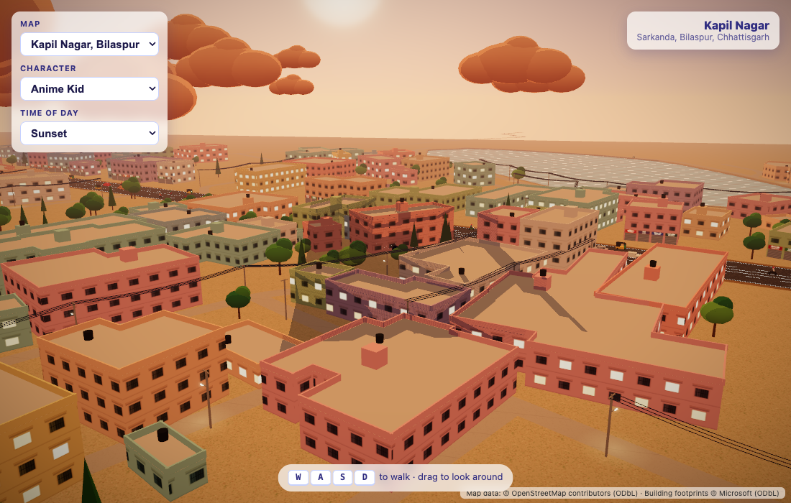
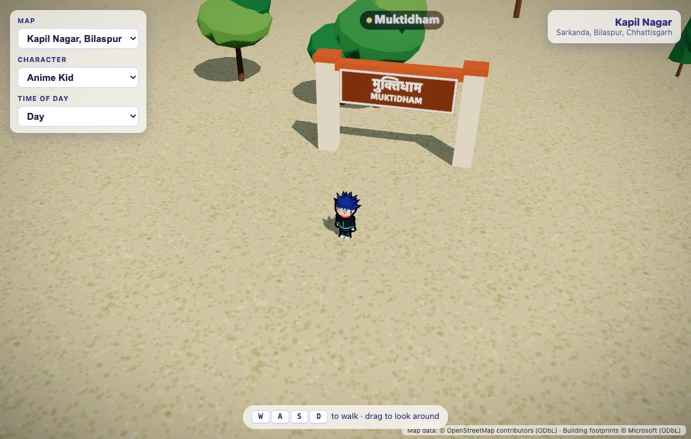
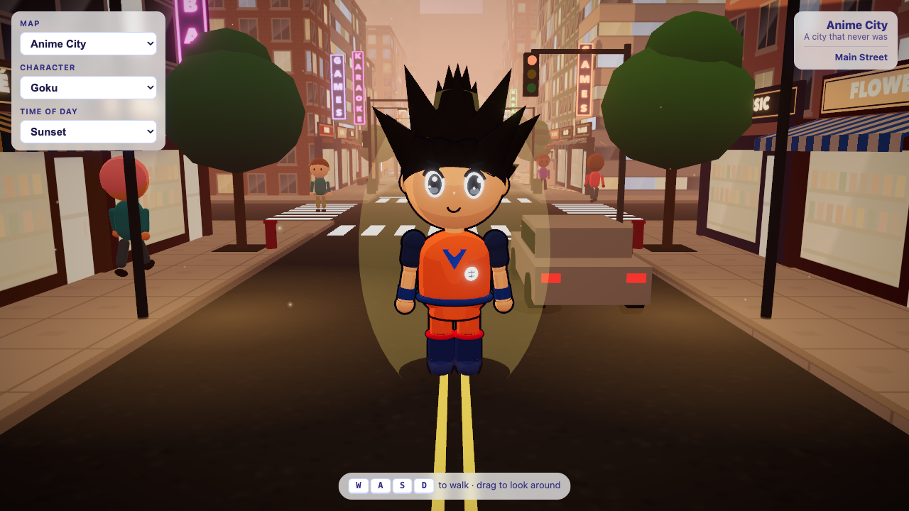
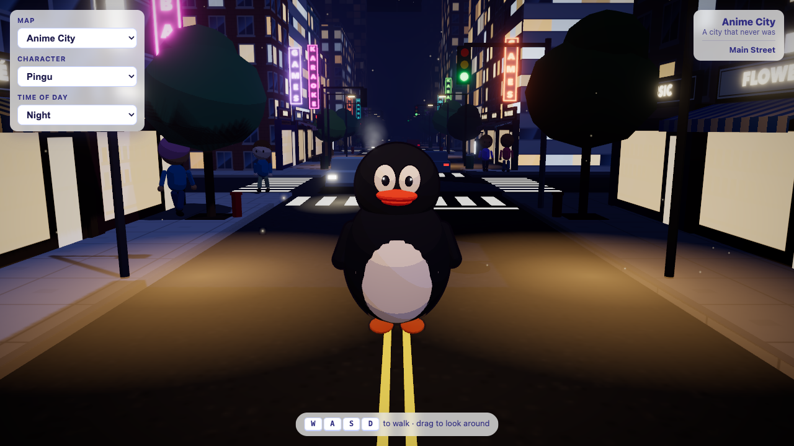

# Anime City

A small 3D walking game in the browser, drawn in a toon/anime style. Pick a character and explore either a fictional anime city or **Kapil Nagar, Bilaspur (Chhattisgarh)**, which is rebuilt from real map data.

Built with React, [three.js](https://threejs.org) and [React Three Fiber](https://r3f.docs.pmnd.rs). Every character and building is generated in code; there are no 3D model files.

| Kapil Nagar, Bilaspur at sunset | Muktidham gate |
| --- | --- |
|  |  |
| **Anime City at sunset (Goku)** | **Anime City at night (Pingu)** |
|  |  |

## Quick start

Requires Node.js 18 or newer.

```sh
npm install
npm run dev
```

Open the URL Vite prints (usually http://localhost:5173).

## Controls

| Input | Action |
| --- | --- |
| `W` `A` `S` `D` or arrow keys | Walk, relative to where the camera is facing |
| Drag | Orbit the camera |
| Scroll | Zoom |

The panel in the top-left switches **Map**, **Character** and **Time of day** (Day, Sunset or Night).

## Maps

### Kapil Nagar, Bilaspur

A real neighbourhood in Sarkanda, Bilaspur:

- **Streets:** Sipat Road and about 90 colony lanes, in their real positions. The top-right card shows the name of the street you're on.
- **Buildings:** 463 real building outlines, styled as local houses: pastel walls, grilled windows, flat roofs with black water tanks, and rows of shops along Sipat Road.
- **Landmarks:** Kapilnath Kashyap Chowk, Ashok Nagar Chowk, Muktidham, the park and the pond, plus a few named shops. Signs are in Hindi and English.
- **Life:** auto-rickshaws, scooters, cars and trucks keep left on Sipat Road; people and cows wander the lanes.

What's real and what's estimated:

| From map data | Estimated or invented |
| --- | --- |
| Street layout and names | Number of floors per building |
| Building outlines | Wall colours and shop types |
| Landmark names and positions | Trees, electric poles, traffic, people |

### Anime City

A fictional city street with shops, neon signs, traffic lights that cars obey, pedestrians, birds and steam from the manholes.

## Characters

Anime Kid, Noddy, Bob the Builder, Pingu, Goku, Ash Ketchum and Courage. All of them share one animation rig: blinking, breathing, a head that follows the mouse, and a walk cycle with knees and elbows.

## Map data

The app doesn't download map data while it runs. `src/data/kapil-nagar.json` is a saved snapshot, created by:

```sh
npm run fetch-map
```

This pulls streets and landmarks from the [OpenStreetMap API](https://www.openstreetmap.org) and building outlines from [Microsoft's Global ML Building Footprints](https://github.com/microsoft/GlobalMLBuildingFootprints). It downloads about 33 MB, then keeps only the area inside the bounding box.

To add another area, change `AREA` in `scripts/fetch-map.mjs` (id, name, centre point and bounding box), run the script, and register the new JSON file in `src/components/maps.js`.

## Project layout

```
scripts/fetch-map.mjs        downloads and saves real map data
src/data/                    saved map snapshots
src/components/
  characters/                characters and the shared animation rig
  city/                      the fictional city, plus the shared sky, lighting and effects
  realmap/                   turns map data into a playable neighbourhood
  Player.jsx                 movement, camera follow and camera collision
  maps.js                    list of available maps
```

## Scripts

| Command | What it does |
| --- | --- |
| `npm run dev` | Start the dev server |
| `npm run build` | Production build into `dist/` |
| `npm run preview` | Serve the production build |
| `npm run lint` | Run ESLint |
| `npm run fetch-map` | Refresh the real-map snapshot |

## Credits

- Map data © [OpenStreetMap contributors](https://www.openstreetmap.org/copyright), ODbL.
- Building footprints © Microsoft, ODbL.

The app shows these credits on screen while you're on a real map. The licence requires them, so keep them visible.

Characters are fan-made tributes to their original creators and are not affiliated with or endorsed by the rights holders.
